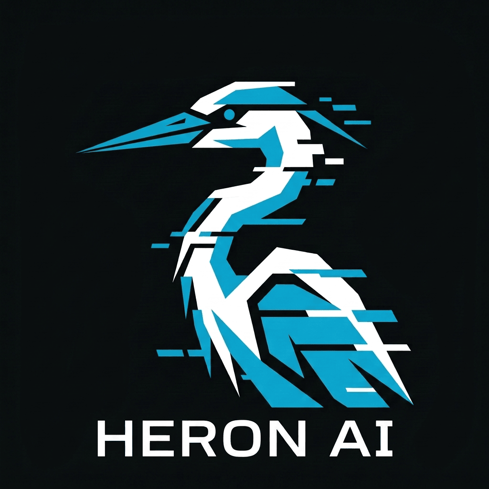
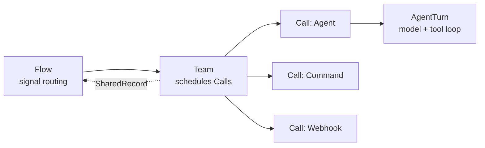

<p align="center">
  
</p>

# Heron AI

<p align="center">
  A multi-agent engine in pure Go — Flow routes, Team schedules, Agent executes.<br>
  All configuration is plain files under <code>.agents/</code>: no database, no daemon.
</p>

<p align="center">
  <a href="https://github.com/janostudio/heron-ai/actions/workflows/ci.yml"></a>
  <a href="https://github.com/janostudio/heron-ai/releases"></a>
  <a href="go.mod"></a>
  <a href="LICENSE"></a>
</p>

<p align="center">
  <b>English</b> · <a href="README.zh-CN.md">中文</a>
</p>

---

## Why Heron

Most agent frameworks start from "a loop that calls tools" and grow an orchestration
layer on top. Heron starts from the orchestration and keeps the loop small:

- **The orchestration is data, not code.** A Flow is a YAML file describing which Team
  runs, what it receives, and where its output goes. Changing the shape of your pipeline
  is a config edit, not a refactor.
- **Three layers, no more.** Flow routes, Team schedules Calls, Call runs an Agent,
  a shell command or a webhook. `Call` is an execution item, not a fourth layer, and
  only the Agent's turn loop talks to a model.
- **Everything is a file.** Sessions are append-only JSONL, state is Markdown,
  knowledge is Markdown, Teams are directories. You can read a whole run with `jq`,
  diff it, or replay it without a special tool.
- **Shareable by construction.** `heron teams` packs a Team with the Agents, Skills,
  rules and knowledge it references into one artifact with a manifest and a
  dependency closure — and never packs your `models.json`.

## Install

```bash
npm install -g @qinghuangniao/heron-ai
heron --version
```

The binary comes from a per-platform npm package (`@qinghuangniao/heron-ai-<platform>`),
so installation only talks to the npm registry — no GitHub download is involved.

From source (Go 1.26+):

```bash
git clone git@github.com:janostudio/heron-ai.git
cd heron-ai
go build -o bin/heron ./cmd/server/
```

## Quick start

Four files and you have a working agent. The walk-through with copy-paste content is in
[docs/getting-started.md](docs/getting-started.md); the shape is:

```bash
mkdir -p my-agent/.agents/{flows,teams,agents/assistant}
cd my-agent

# 1. .agents/models.json            model registry (the only required file)
# 2. .agents/flows/default.yml      who runs first
# 3. .agents/teams/hello_team.yml   what gets called
# 4. .agents/agents/assistant/AGENT.md   who does the work

export OPENAI_API_KEY=sk-your-key
heron --check-config    # validate definitions before spending tokens
heron                   # interactive TUI
heron --prompt "hello"  # one turn, then exit
```

`heron --check-config` is the cheap gate: it loads and validates everything without
building a model client or opening a session, and prints each Team binding's lifecycle.

## What it does

| Capability | How |
|---|---|
| **Orchestration** | `Flow → Team → Call → AgentTurn`, with signal routing (`continue` / `wait_input` / `goal_achieved` / `goal_failed` / `goal_impossible`) and typed records passed between layers |
| **Agents** | Persona, per-agent tools, skills, knowledge, rules, guardrails, hooks, structured output, handoff, HITL approvals |
| **Tools** | 20 builtin (`Read`, `Write`, `Bash`, `Grep`, `Glob`, `WebSearch`, `WebFetch`, `CodeNav`, `TodoWrite`, `Spawn`, `Team`, `State`, `Define`, …), plus custom tools and MCP servers. `REPL` is a 21st, enabled only via `settings.json` |
| **Run modes** | TUI · one-shot `--prompt` · long-lived JSON-RPC over stdin/stdout · HTTP server with SSE and a bundled Web UI · `stream-json` client |
| **Team packages** | `heron teams` — install / remove / export, with manifest, dependency closure and script review |
| **Knowledge** | `heron knowledge` distills finished sessions into Markdown entries; `gc` archives by `ExpiresAt` |
| **Multimedia** | Image / file content blocks over HTTP and CLI |
| **Storage** | `.agents/data/sessions/<id>/{flow,team,agent}.jsonl` — one append-only log split by producing layer |

## Architecture



Only `AgentTurn` talks to a model. Team-to-Team hand-off, retries and termination are
decided by signals, and every turn leaves the session continuable — a failure is
reported on that turn's result, never as a dead session. Package layout and the full
data model are in [docs/architecture.md](docs/architecture.md).

```text
.agents/
├── flows/         # Flow definitions (YAML)
├── teams/         # Team configurations (YAML)
├── agents/        # <id>/AGENT.md + knowledge/ + rules/
├── skills/        # SKILL.md + scripts/ + references/
├── knowledge/     # Knowledge base (Markdown)
├── rules/         # Global rules
├── _teams/        # Installed Team packages (managed by `heron teams`)
├── models.json    # Model registry
├── settings.json  # Engine settings (optional)
└── data/          # Runtime data: sessions/, logs/
```

### models.json

```json
{
  "model": "hy3-ioa",
  "models": [
    {
      "id": "hy3-ioa",
      "name": "hy3-ioa",
      "protocol": "openai_chat",
      "base_url": "https://api.openai.com/v1",
      "api_key": "${OPENAI_API_KEY}",
      "maxOutputTokens": 64000
    }
  ]
}
```

`model` selects the default profile by `name`. `api_key` expands `${ENV_VAR}`; when
omitted, the protocol's conventional variable (`OPENAI_API_KEY` / `ANTHROPIC_API_KEY`)
is used. A `${VAR}` that resolves to nothing is an error, not a silent fallback to
another provider's key.

### settings.json

Optional. Carries log policy, runtime safety backstops, the `WebSearch` / `WebFetch`
data source, MCP servers, extra Bash policy phrases and env vars for subprocesses.
Fields that no longer have a reader are listed explicitly in
[docs/configuration/settings.md](docs/configuration/settings.md#inert-sections) — so
nobody tunes a knob that does nothing.

## Examples

Each example is a complete `.agents/` tree you can copy as a starting point. They are
loaded by CI through the real config loader, so one that stops validating fails the
build instead of rotting.

| Example | Description | Agents | Teams | Flow |
|---|---|---|---|---|
| [simple-qa](examples/simple-qa/) | Single agent Q&A | 1 | 1 | `flows/default.yml` |
| [code-review](examples/code-review/) | Parallel reviewers + aggregate | 3 | 1 | `code_review.yml` |
| [blog-writer](examples/blog-writer/) | Three-stage content pipeline | 4 | 3 | `flows/blog.yml` |
| [novel-rp](examples/novel-rp/) | Multi-character roleplay | 3 | 3 | `flows/flow.yml` |

Models and keys are local to the receiving side and never shipped with a sample — see
[examples/README.md](examples/README.md) for the one-file template and per-example run
commands.

## Documentation

Start at [docs/INDEX.md](docs/INDEX.md) — it routes by task and marks each document's
language. The most-used entries:

| Document | What it answers |
|---|---|
| [Getting Started](docs/getting-started.md) | Four files from nothing to a working agent |
| [Architecture](docs/architecture.md) | Layers, package structure, signal routing, where data lives |
| [Configuration](docs/CONFIGURATION.md) | Every config file, with per-file detail |
| [CLI](docs/CLI.md) | Every flag, TUI, HTTP server, JSON-RPC, `stream-json`, `teams` |
| [Context Management](docs/context-management.md) | What one AgentTurn actually sends to the model |
| [Multimedia Input](docs/MULTIMEDIA-INPUT.md) | Image and file content blocks |
| [Team Sharing](docs/generic-engine/30-team-sharing.md) | Package manifest, dependency closure, install rules |
| [Troubleshooting](builtin/skills/heron-ai-config/SKILL.md) | Where a session's data lives and how to read it |

## Development

```bash
go build ./...
go test ./...
golangci-lint run     # config in .golangci.yml
```

CI runs build, docs-link check, full tests with `-race`, and golangci-lint on every
push and pull request. See [CONTRIBUTING.md](CONTRIBUTING.md) for the workflow.

## Roadmap

See [ROADMAP.md](ROADMAP.md). The short version: the orchestration core is done. Open
items are the extension runtime (Lua / WASM), a browsable docs site, and surfacing eval
output in the CLI.

## License

MIT — see [LICENSE](LICENSE).
