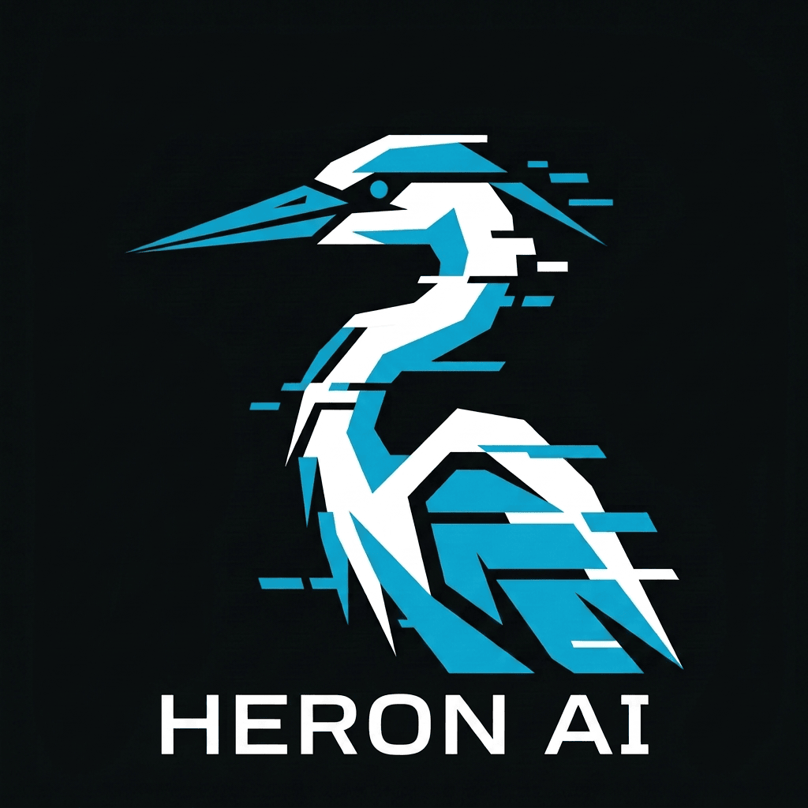
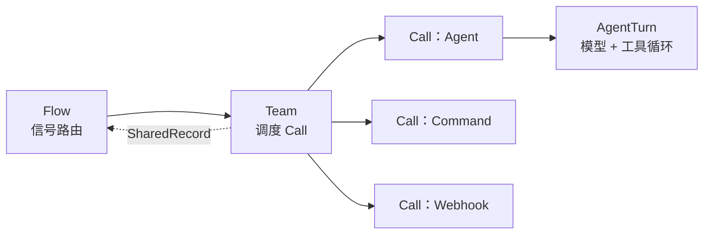

<p align="center">
  
</p>

# Heron AI

<p align="center">
  纯 Go 实现的多 Agent 引擎 —— Flow 负责路由，Team 负责调度，Agent 负责执行。<br>
  全部配置就是 <code>.agents/</code> 下的普通文件：没有数据库，没有常驻守护进程。
</p>

<p align="center">
  <a href="https://github.com/janostudio/heron-ai/actions/workflows/ci.yml"></a>
  <a href="https://github.com/janostudio/heron-ai/releases"></a>
  <a href="go.mod"></a>
  <a href="LICENSE"></a>
</p>

<p align="center">
  <a href="README.md">English</a> · <b>中文</b>
</p>

---

## 为什么是 Heron

多数 Agent 框架的起点是"一个调工具的循环"，编排层是后来加上的。Heron 反过来：
编排是主体，循环保持很小。

- **编排是数据，不是代码。** 一个 Flow 就是一份 YAML：哪个 Team 跑、收到什么、
  产出交给谁。改变流水线形状是改配置，不是重构。
- **只有三层。** Flow 路由、Team 调度 Call、Call 执行 Agent / shell 命令 / webhook。
  Call 是执行项而不是第四层，而且只有 Agent 的回合循环会调模型。
- **一切都是文件。** 会话是 append-only JSONL，状态是 Markdown，知识是 Markdown，
  Team 是目录。一次运行可以用 `jq` 读完、可以直接 diff、可以重放。
- **天生可分享。** `heron teams` 把一个 Team 连同它引用的 Agent、Skill、规则、知识
  打成一份带 manifest 和依赖闭包的包 —— 且永远不会打包你的 `models.json`。

## 安装

```bash
npm install -g @qinghuangniao/heron-ai
heron --version
```

二进制由对应平台的 npm 包（`@qinghuangniao/heron-ai-<platform>`）提供，安装只访问
npm registry，不会从 GitHub 下载。

源码构建（Go 1.26+）：

```bash
git clone git@github.com:janostudio/heron-ai.git
cd heron-ai
go build -o bin/heron ./cmd/server/
```

## 快速开始

四个文件得到一个能对话的 Agent。可直接复制的完整内容见
[docs/getting-started.md](docs/getting-started.md)，形状如下：

```bash
mkdir -p my-agent/.agents/{flows,teams,agents/assistant}
cd my-agent

# 1. .agents/models.json                模型注册表（唯一必需文件）
# 2. .agents/flows/default.yml          谁先跑
# 3. .agents/teams/hello_team.yml       调用哪些执行项
# 4. .agents/agents/assistant/AGENT.md  谁干活

export OPENAI_API_KEY=sk-your-key
heron --check-config    # 先校验定义，不花 token
heron                   # 交互式 TUI
heron --prompt "你好"    # 跑一轮就退出
```

`heron --check-config` 是最便宜的一道门禁：只做加载与校验，不建模型客户端、不开会话，
并打印每个 Team 绑定的 lifecycle。

## 能力一览

| 能力 | 实现方式 |
|---|---|
| **编排** | `Flow → Team → Call → AgentTurn`，信号路由（`continue` / `wait_input` / `goal_achieved` / `goal_failed` / `goal_impossible`），层间用带类型的 record 传递数据 |
| **Agent** | Persona、按 agent 授权的工具、Skill、Knowledge、Rules、Guardrail、Hooks、结构化输出、Handoff、HITL 审批 |
| **工具** | 20 个内置（`Read`、`Write`、`Bash`、`Grep`、`Glob`、`WebSearch`、`WebFetch`、`CodeNav`、`TodoWrite`、`Spawn`、`Team`、`State`、`Define` 等），另支持自定义工具与 MCP server；`REPL` 是第 21 个，需在 `settings.json` 显式开启 |
| **运行方式** | TUI · `--prompt` 单轮 · stdin/stdout 常驻 JSON-RPC · 带 SSE 与内置 Web UI 的 HTTP server · `stream-json` 客户端 |
| **Team 包** | `heron teams` 安装 / 卸载 / 导出，带 manifest、依赖闭包与脚本复核 |
| **知识** | `heron knowledge` 把已结束的会话提炼成 Markdown 条目，`gc` 按 `ExpiresAt` 归档 |
| **多媒体** | HTTP 与 CLI 都接受图片 / 文件内容块 |
| **存储** | `.agents/data/sessions/<id>/{flow,team,agent}.jsonl` —— 一份 append-only 日志按产生层级分流 |

## 架构



只有 `AgentTurn` 会调模型。Team 之间的交接、重试与终止由信号决定，而且**每一轮结束
都会让会话保持可续**——失败只体现在那一轮的结果上，不会把会话变成死会话。包结构与
完整数据模型见 [docs/architecture.md](docs/architecture.md)。

```text
.agents/
├── flows/         # Flow 定义（YAML）
├── teams/         # Team 定义（YAML）
├── agents/        # <id>/AGENT.md + knowledge/ + rules/
├── skills/        # SKILL.md + scripts/ + references/
├── knowledge/     # 知识库（Markdown）
├── rules/         # 全局规则
├── _teams/        # 已安装的 Team 包（由 `heron teams` 管理）
├── models.json    # 模型注册表
├── settings.json  # 引擎行为配置（可选）
└── data/          # 运行数据：sessions/、logs/
```

### models.json

```json
{
  "model": "hy3-ioa",
  "models": [
    {
      "id": "hy3-ioa",
      "name": "hy3-ioa",
      "protocol": "openai_chat",
      "base_url": "https://api.openai.com/v1",
      "api_key": "${OPENAI_API_KEY}",
      "maxOutputTokens": 64000
    }
  ]
}
```

`model` 按 `name` 选默认模型。`api_key` 支持 `${ENV_VAR}` 展开；整段省略时按协议读
`OPENAI_API_KEY` / `ANTHROPIC_API_KEY`。`${VAR}` 展开为空**会直接报错**，不会退回
另一个厂商的 key。

### settings.json

可选。承载日志策略、runtime 安全上限、`WebSearch` / `WebFetch` 的数据源、MCP 服务、
额外的 Bash 策略短语，以及注入子进程的环境变量。已经没有任何代码读取的配置段在
[docs/configuration/settings.md](docs/configuration/settings.md#inert-sections) 里
明确列出——免得有人去调一个不起作用的开关。

## 示例

每个示例都是一份完整的 `.agents/` 目录，可以整目录复制当起点。CI 会用真正的加载器
逐个加载，哪个示例改坏了就构建失败，不会悄悄过期。

| 示例 | 说明 | Agent | Team | Flow |
|---|---|---|---|---|
| [simple-qa](examples/simple-qa/) | 单 Agent 问答 | 1 | 1 | `flows/default.yml` |
| [code-review](examples/code-review/) | 并行评审 + 汇总 | 3 | 1 | `code_review.yml` |
| [blog-writer](examples/blog-writer/) | 三阶段内容流水线 | 4 | 3 | `flows/blog.yml` |
| [novel-rp](examples/novel-rp/) | 多角色扮演 | 3 | 3 | `flows/flow.yml` |

模型与 key 属于使用方本地环境，不随示例分发——通用模板与逐个示例的启动命令见
[examples/README.md](examples/README.md)。

## 文档

从 [docs/INDEX.md](docs/INDEX.md) 进：它按"你要做什么"分流，并标注每篇的语言。最常用
的几篇：

| 文档 | 回答什么问题 |
|---|---|
| [快速开始](docs/getting-started.md) | 四个文件从零跑通第一轮 |
| [架构](docs/architecture.md) | 分层、包结构、信号路由、数据落在哪 |
| [配置总览](docs/CONFIGURATION.md) | 所有配置文件，逐项链接到细节 |
| [CLI 命令](docs/CLI.md) | 全部 flag、TUI、HTTP server、JSON-RPC、`stream-json`、`teams` |
| [上下文管理](docs/context-management.md) | 一次 AgentTurn 到底发什么给模型 |
| [多媒体输入](docs/MULTIMEDIA-INPUT.md) | 图片与文件内容块 |
| [Team 分享](docs/generic-engine/30-team-sharing.md) | 包 manifest、依赖闭包、安装规则 |
| [运行排查](builtin/skills/heron-ai-config/SKILL.md) | 一次会话的数据在哪、怎么看 |

## 开发

```bash
go build ./...
go test ./...
golangci-lint run     # 配置见 .golangci.yml
```

CI 在每次 push 与 PR 上跑构建、文档链接检查、带 `-race` 的全量测试和 golangci-lint。
协作流程见 [CONTRIBUTING.md](CONTRIBUTING.md)。

## 路线图

见 [ROADMAP.md](ROADMAP.md)。一句话版本：编排内核已完成，剩下的是扩展运行时
（Lua / WASM）、可浏览的文档站点，以及把 eval 结果接到 CLI。

## 许可证

MIT —— 详见 [LICENSE](LICENSE)
